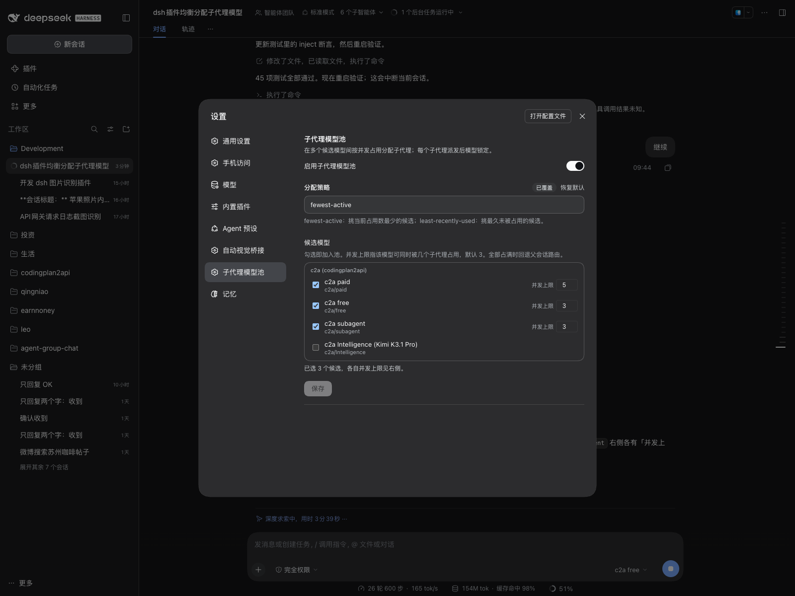
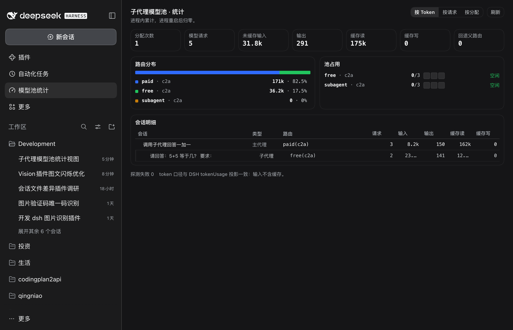

# dsh-subagent-model-pool

子代理模型池：按并发占用在多个候选模型间分配，同一子代理派发后模型锁定。

带 Web GUI 设置页，候选模型从 DSH 的实时模型目录里勾选。



v0.4.0 起带**统计视图**：侧栏「模型池统计」面板，一页看完分配、请求与 token 四桶。



## 行为

- 子代理**创建时、初始任务释放前**完成候选探测并通过 `agent.model.select()` 选定模型，此后全程锁定。适配 DSH 0.2.2 的 step preparation 约束。
- 每个候选有独立的 `maxConcurrent`（默认 **3**），语义是**并发占用数**，不是累计次数。
- 占用由 `subagent/end` 释放，按 `runId` 幂等。冷恢复会开新 run，各自独立计数。
- 池全满、预检失败或子代理被显式指定模型时，**静默回退父会话路由**，永不阻断子代理。

## 配置

插件自带的 `cordis.patch.yml` 提供默认配置，profile 层用顶层 `- id:` 覆盖（**必须带 `name`**，原因见「安装」）：

```yaml
- id: subagent-model-pool
  name: dsh-subagent-model-pool
  config:
    enabled: true
    strategy: strict-priority    # 或 fewest-active / least-recently-used
    pools:
      - provider: c2a
        model: subagent
        maxConcurrent: 3
      - provider: c2a
        model: free
        maxConcurrent: 3
```

也可以直接用设置页改，无需手写 YAML。

| 字段 | 默认 | 说明 |
|---|---|---|
| `enabled` | `true` | 关闭后所有子代理沿用父路由 |
| `strategy` | `fewest-active` | 见下方策略表 |
| `pools[].provider` / `.model` | 必填 | 候选路由 |
| `pools[].maxConcurrent` | `3` | 该模型同时可被几个子代理占用 |

策略在初始态（全员 `active=0`）按**配置数组顺序**做稳定 tiebreak，保证并发首次派发不打散。

## 排除规则

以下子代理不参与池化，直接走原路由：

- 非子代理（`header.origin !== "subagent"` 或无 `parentSession`）——保护主会话的模型切换。
- `fork` 子代理——它继承父对话前缀，换模型会作废 KV 缓存。
- 显式指定了模型的子代理——包括显式路由恰好等于父路由的情况。插件在 `subagents.startActivation()` 的原始参数上保留显式标记，不再靠合并后的路由差值猜测。若无法安全安装该标记，插件会停用池分配，而不是误覆盖。

## 统计视图

侧栏「模型池统计」图标 → 独立主页面。数据来自 Host 半注册的 Connection 精确 Fetch 路由 `/api/subagent-pool.stats`（浏览器同源 fetch，带会话 cookie）。

页面分四块：

| 区块 | 内容 |
|---|---|
| 合计条 | 分配次数、模型请求、未缓存输入、输出、缓存读、缓存写、回退父路由 |
| 路由分布 | 一条堆叠条 + 每条路由的占比；可切「按 Token / 按请求 / 按分配」三种口径 |
| 池占用 | 每个池内候选的并发槽位图（空闲 / 占用中 / 满载 / 探测失败）与当前占用数 |
| 会话明细 | 主会话与子代理分行（子代理缩进），各自请求数与 token 四桶 |

口径说明：

- **token 四桶分开**：输入是**未缓存输入**，缓存读、缓存写另计，与 DSH 的 `tokenUsage` 投影（`dsh-token-meter`）同义，不能合并成单一「输入」。
- **替换语义**：同一个 turn/step 重复结算取最新值；`llm/retry-started` 会作废上一个槽，重试的那次全额计入（与 `dsh-token-meter` 同口径）。
- **进程内累计**：账本在插件 `apply` 闭包里，进程重启后归零；配置热更新换池不影响账本。
  - **为什么不回读历史**：DSH 的会话日志本身是持久的（`~/.dsh/sessions/<工作区目录转码>/<agentId>/session.v4.jsonl.zstd`，含 `assistant/message` 的 usage、`request/header` 的路由、`session/title` 的标题），但本插件**只从 `session/event` 实时事件流记账**，不回放历史日志。
  - 标题是唯一的例外：`sessionTitle.get(session)` 直接读会话日志折叠出的最新标题快照，所以插件挂载前就命名的会话也能显示标题。
  - 想要跨重启的历史统计有三条路：① 插件自己落盘账本（仿 `dsh-schedule` 的 `schedule.json`）；② 启动时回放 `~/.dsh/sessions/**` 重算（口径天然与 DSH 一致，但要解析 zstd + jsonl）；③ 走 DSH 的 `sessionProjections`（投影状态由 DSH 持久化到 `~/.dsh/storages/session_projcache/`）。当前版本三条都没做——进程内累计是刻意选择，不是遗漏。
- **路由归属**：`assistant/message` 用 `message.source`（这次实际走的路由）；失败/中断的 `assistant/attempt` 没有 `source`，改用该会话 `request/header` 记住的路由归因。

## 安装

三步，缺一不可。**注册方式错了插件会静默不挂载**（服务正常启动、零报错、设置页也不出现）。

1. 建软链：

```bash
ln -s /path/to/dsh-subagent-model-pool ~/.dsh/profiles/web/node_modules/dsh-subagent-model-pool
```

2. 在 profile 的 `package.json` 里同时登记依赖与 bundle：

```json
{
  "dependencies": {
    "dsh-subagent-model-pool": "link:/path/to/dsh-subagent-model-pool"
  },
  "dsh": {
    "profile": {
      "bundles": ["...", "dsh-subagent-model-pool"]
    }
  }
}
```

`bundles` 列表决定插件自己的 `cordis.patch.yml`（里面是 `- insert:`）是否被应用；只有 `dependencies` 而没有 `bundles`，插件不会进配置树。

3. 插件 entry 由它自己的 bundle patch 注册，profile 的 `cordis.patch.yml` 里**只用顶层 `- id:` 覆盖 config**，且**必须带 `name`**：

```yaml
- id: subagent-model-pool
  name: dsh-subagent-model-pool
  config:
    enabled: true
    strategy: fewest-active
    pools:
      - provider: c2a
        model: subagent
        maxConcurrent: 3
```

两个坑都在 `dsh-config-editor` 的 `edit`：

- 带 `config` 的 `- insert:` 会让设置页保存失败——`edit` 只改顶层条目，insert 块里的旧 config 残留，触发 `overridden` 守卫。
- 顶层条目缺 `name` 会让设置页保存时追加**重复条目**——`edit`（`dsh-config-editor/lib/index.js:98`）用 `id` + `name` 双条件匹配。

自检：

```bash
dsh --dump-config --profile web | grep -c "^- id: subagent-model-pool"   # 必须是 1
dsh --dump-config --profile web | grep "^# == dsh-subagent-model-pool"   # 必须有 bundle 段
```

重启 web 服务生效（macOS launchd；其他方式启动的话重启对应进程即可）：

```bash
launchctl kickstart -k gui/$(id -u)/com.leo.dsh-web
```

## 设置页

「设置」→「子代理模型池」：

- **启用开关**
- **分配策略**（权重字段 `weight` 的语义随策略变化，默认 1）：

| 策略 | weight 的含义 | 行为 |
|---|---|---|
| `fewest-active`（占用最少优先） | 期望占用占比 | 选「活跃占用 ÷ 权重」比值最小者；稳态占用趋近权重比例（8:2 → 80%:20%）。全为 1 时退化为旧行为 |
| `least-recently-used`（最久未用优先） | 不生效 | 挑最近一次释放最早的候选 |
| `strict-priority`（严格主备） | 优先级，从大到小 | 高权重候选未占满自己的 `maxConcurrent` 时绝不轮到低权重；占满即溢出到下一级，释放后新派发回到最高可用级。权重相同按配置数组序 |

「用完」的口径统一是**并发占满**（瞬时状态），与历史累计派发次数无关；已派到低优先级的存量 run 不迁移，跑完为止（派发即锁定）。
- **候选模型**：交互式复选框列表，候选来自 `llm` 的实时模型目录（按 provider 分组）。勾选即加入池，已勾选项右侧可单独设 `maxConcurrent`。

改动后点「保存」写回 `cordis.patch.yml`。全部占满时回退父会话路由。

### 实现细节

- `Config` 必须带顶层 `.volatile()`。`dsh-settings` 的 `describe()` 用 `volatileForm` 过滤命名空间（`dsh-settings/lib/index.js:122-131`），不含 volatile 的 schema 根本不会出现在设置里。
- **带 `.volatile()` 后，`apply(ctx, config)` 收到的不是普通对象，而是 cosmokit 的 volatile 引用** `{ get(), [Symbol.for("cosmokit.volatile.write")] }`（`schemastery/lib/index.mjs:480` → `cosmokit createVolatile`）。直接读 `config.pools` 永远是 `undefined`，插件会静默不装配——必须用 `config.get()` 解包。设置页保存后 `dsh-settings` 通过 `[write]` 更新该引用，所以 `get()` 每次都能读到最新值。
- **数组字段不要走 `SettingsFormModel` 的标量 field**。它的 field 工厂只表达标量，`format` 把数组序列化成字符串后，回读时类型已经丢了。正确做法是本地草稿 + `scope.mutate([{op:"set", path:["pools"], value}])` 直接写，参照内置 `dsh-client-ui-settings-subagent` 的模型多选卡。
- `actions()` 只暴露 `edit` / `resetField` / `discard`，**没有读取待提交队列的入口**。所以标量（策略）交给 `form.save()`，数组（池）由控制器自己 `scope.mutate`，两者分开提交。
- `exports.inject` 必须包含 `remote` 和 `remote.session`，否则读 `ctx.remote.session.modelCatalog()` 会抛 `cannot get property "remote" without inject`，**整个客户端条目 boot 失败**（页面显示 `1 entry did not activate`）。
- 模型目录里已不存在的候选仍要渲染（标记「已下线」），否则用户既看不到也删不掉它。
- 候选键用 `JSON.stringify([provider, model])` 而不是 `${provider}\0${model}`：后者在任一侧自带分隔符时会碰撞。
- 配置热更新：volatile 引用的写入无法订阅，所以在每次 `agent/created` 前比对配置指纹（`signatureOf`），变了就整体换池。设置页改完**无需重启**。

### 统计视图的实现要点

- **取数走 Connection 的精确 Fetch 路由**，不自建 HTTP 服务：`ctx.connection.fetch.register({path, methods, requestBody, fetch})`，路径必须在 `/api` 下。Connection 已经把 Host/Origin 围栏与浏览器会话鉴权做完（`dsh-client-connection/lib/index.js:742` `admit()`），第三方插件自己开路由等于重写一遍鉴权。
- **鉴权实测（隔离实例 :3099）**：

  | 请求 | 结果 |
  |---|---|
  | 无凭据 | 401 unauthorized |
  | 启动 token（`?token=`） | 401——页面启动凭据不是 API 凭据 |
  | `sec-fetch-site: cross-site` | 403 forbidden |
  | 异源 `Origin` | 403 forbidden |
  | 伪造 `Host` | 403 forbidden |
  | 对照组内建 `/api/present.host` 无凭据 | 401（整个 `/api` 前缀同一把锁） |
  | 浏览器登录态 fetch / 有效 cookie + curl | 200 + 统计数据 |

  源码链路：`/api` prefix 路由 → `connection.admit(req)`（:742）→ 通过才 `bridge(req, res, fetchHandler, admission.peer, …)`（:1055）→ `createSharedFetchHandler` 再查 `peer.principal.kind !== "owner"` 返 403（:831）。浏览器会话 cookie 是 HMAC 签名（`decodeCookie(value, this.secret)`），无法伪造。cookie 兑换链：`GET /?token=<启动token>` → 303 + `set-cookie: dsh-auth-<sha256(authority)>`（HttpOnly; SameSite=Strict）→ 带 cookie 才能打 API；**query token 本身不是 API 凭据**。
- **不需要额外包 `ctx.effect`**：`registerFetchRoute` 内部已 `owner.effect(...)`（:847-853），且 `owner` 解析为调用方插件的 fiber ctx——插件卸载时路由自动摘除。实测：dispose fiber 后路由 404；双插件互斥时 dispose A 只影响 A（B 仍 200），重载 A 无 "already registered" 冲突。
- **与 `connection.rpc.handle` 无安全差异，且本方案更严**：两者都在同一位置调 `admit()`（`rpc.handle` 在 :862，精确路由在 :1049 的 prefix handler）；精确路由**额外**有一道 `peer.principal.kind !== "owner"` 检查（:830），`rpc.handle` 没有。本方案还少一层 `{ok, value}` 包络，handler 抛异常不会变 500 纯文本。RPC 的唯一优势是能挂非 `/api` 的自定义通道——精确 Fetch 路由**必须**在 `/api` 下（`assertFetchRoute` → `endpointFromPath("/api", path)`，:974），本插件路径已符合。
- **`connection` 不能进顶层 `inject`**：非 Web profile（headless / avb-lab）没有这个服务，顶层声明会让插件整体不挂载。改用嵌套 `ctx.inject(["connection"], cb)`，Web 环境自动补上，其他环境安静地不提供统计页。
- **面板挂载用 slots**：`ctx.slots.inject("main", …)` 注册 keyed 主页面（key = `subagent-model-pool`），`ctx.slots.inject("sidebar.panellist", …)` 注册侧栏条目（id + order + label）。先例是内置的「插件管理」页与「任务」页。
- **`jsx` 是 automatic runtime**：`jsx(type, props, key)`，多子元素必须写进 `props.children`（`children: [...]`）。写成 `jsx(type, props, child1, child2)` 会在渲染时抛 `Cannot read properties of null (reading 'key')`。
- **统计页的 store 用普通 prop 下发**：`inject` 面里的 `hooks` 会被渲染器绑成选择器钩子，而这里要传的是一个带 React hooks 的函数，只能当普通 prop 传（`{ useStats: fn }`）。
- **账本必须由 `apply` 闭包持有**，不能挂在池实例上：配置热更新会整体换池，挂在池上历史就丢了。

## 实测验证（2026-11-02 ~ 11-03）

分配行为：

| 场景 | 分配结果 |
|---|---|
| 单独派发 | `c2a/subagent` |
| 两个并发 | `c2a/subagent` + `c2a/free` |
| 前两者释放后再派 | `c2a/subagent` |

设置页（浏览器实测）：

| 操作 | 结果 |
|---|---|
| 打开设置页 | 左侧导航出现「子代理模型池」；候选以复选框呈现，按 provider 分组，4 个 c2a 模型全部列出 |
| 勾选 `c2a/paid` | 该行右侧出现「并发上限」输入框（默认 3），汇总变「已选 3 个候选」，保存按钮启用 |
| 上限改 5 后保存 | `cordis.patch.yml` 新增 `paid / maxConcurrent: 5`；按钮回 disabled，无失败提示 |
| 取消勾选 | 该行上限框消失，保存后条目被移除 |
| 改 `maxConcurrent` 等于继承值保存 | 条目被删除，回落到 bundle 默认值——这是 `edit` 的正确语义 |

测试：`node --test tests/*.test.js`，116 项全通过（2026-11-06，含 DSH 0.2.2 创建期选路、显式同/异路由、fork、冷恢复、探测回退与统计视图回归）。

统计视图端到端实测（2026-11-06，DSH Web 临时实例 :3099）：

| 场景 | 结果 |
|---|---|
| 取数路由 | `GET /api/subagent-pool.stats` → 200，结构 `{routes, totals, sessions}` |
| 侧栏入口 | 侧栏出现「模型池统计」，点击挂载独立主页面 |
| 真实子代理 | 派一个子代理后：分配次数 1、模型请求 6、路由 `c2a/free` 归到子代理、`c2a/paid` 归到主代理 |
| 页面渲染 | 堆叠条双色分段（paid 73.7% / free 26.3%）、池占用只列池内候选、会话明细父子缩进 22px |
| 密度实测 | 卡片 95×51px、路由行 22px、表格单元格 26px（字号 11px / 行高 17px） |


## 实现要点

- 监听装在**无 scope tag** 的插件 ctx 上，才能收到全部子/孙代理事件（`dsh-scope/lib/index.js:332`）。
- DSH 0.2.2 起禁止在 `agent/request` 改变已固定的 provider/model；分配必须在 `agent/created` 中完成并调用 `agent.model.select()`（`dsh-agent-loop/lib/index.js:1000-1001`）。
- `agent/created` 是 serial 且会被 await，早于初始 prompt 投递；普通 `subagent` 与 workflow 都经过此节点。
- 显式性只能在父子路由合并前保留：`startActivation(spec)` 的原始 `request.agentOptions` 是判据，内部布尔标记随展开进入当前子代理，但不会通过父代理的已知路由字段遗传给孙代理。
- 冷恢复沿用已持久化的 `request/header` / `model/selection`，不重新探测；`fork` 不参与池化。
- 选、占、记在同一同步块内完成，中间不 `await`——workflow 并发 fan out 否则会超发。探测或选路失败必须释放占用。

## 开发

需要 Node ≥ 20.18。`index.js` / `lib/**` 从 dsh 自带目录导入 `@deepseek-ai/cordis` 与 `@deepseek-ai/schemastery`，所以本地跑测试要先建软链：

```bash
DSH_ROOT=~/.local/lib/node_modules/@deepseek-ai/dsh/node_modules/@deepseek-ai
mkdir -p node_modules/@deepseek-ai
ln -s "$DSH_ROOT/cordis"      node_modules/@deepseek-ai/cordis
ln -s "$DSH_ROOT/schemastery" node_modules/@deepseek-ai/schemastery
```

然后：

```bash
node --test tests/*.test.js
```

`client.js` 是浏览器半身，测试用最小 `window` 桩加载，不依赖 DOM。

## License

MIT
